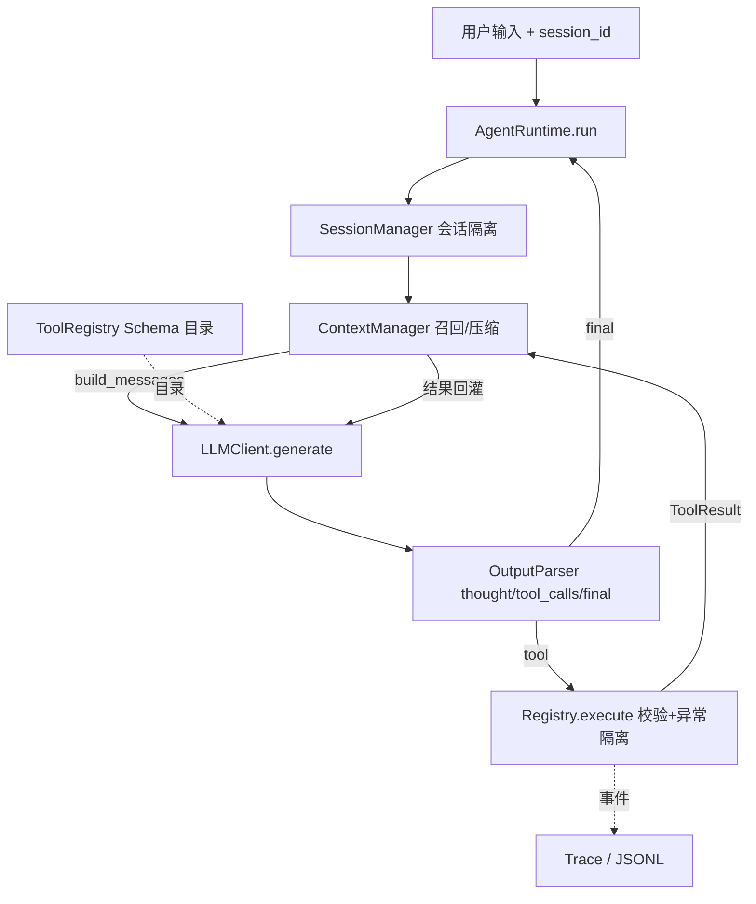

# Mini-Agent｜从零实现的 Agent Harness

**https://github.com/ByteDancer95/mini-agent** · Python ≥ 3.10 · 零第三方依赖 · 零密钥可跑

> **这是一道 Agent Harness 技术笔试题。** 重点不是「做了一个多聪明的业务助手」，
> 而是自研那层把模型包成**可运行、可观测、可复现系统**的执行外壳：主循环与停止条件、
> 工具 Schema 注册与执行隔离、context 生命周期、多 session 状态、trace、容错与批量评测。
> LLM 被收敛成 `generate(messages, tool_schemas) -> LLMResponse` 一个可替换组件 ——
> 正因如此，`HeuristicLLM` / `ScriptedLLM` / 本地 fake HTTP 端点才能零密钥验证整条链路。
> **这不是妥协，而是 Harness 题要求的可复现性本体。**

不依赖 langgraph / openhands / openclaw。交付物是**一个自研 Agent Harness（`core/` 下的 Runtime）
+ 挂在它上面的最小示例 Agent「小田」**：小田只用来验收外壳能不能把决策者跑起来，
不是垂直业务 bot，重心也不在 persona。

> **关于「最小可用」的取舍**：题目要的是最小可用，不是功能最多。当前只有 **2 个入口**
> （`cli.py` 交互/演示、`walkthrough.py` 导出决策证据）。开发过程中曾做过 4 个入口、
> 479 行 README、295 行生成实录，后来全部合并或删除 —— 详见 `PROMPT_LOG.md` 的「过度工程与减法」。

---

## 1. 运行方式

```bash
git clone https://github.com/ByteDancer95/mini-agent.git && cd mini-agent

python -m mini_agent.cli --demo          # 题目指定的双窗口隔离演示
python -m mini_agent.cli                 # 交互对话
python -m mini_agent.cli --trace --trace-file logs/t.jsonl
python -m mini_agent.cli --check-llm     # 只读自检真实 LLM 配置（不请求、不打印密钥）
python -m mini_agent.walkthrough         # 逐帧导出一轮决策链路（协议证据）
python -m unittest discover -s tests -v        # 143 个用例
python -m unittest tests.test_harness_eval -v  # case 批量评测 + 确定性重放
```

未配置 LLM 时自动降级为 `HeuristicLLM` —— **本地确定性替身，不是 AI**，只用来在没有 key 的
环境里验证 loop / 解析 / 工具 / 隔离的数据形态。接真实模型：

```bash
cp .env.example .env   # .env 已被 .gitignore 忽略
# 填入 MINI_AGENT_API_KEY / MINI_AGENT_BASE_URL / MINI_AGENT_MODEL
python -m mini_agent.cli --llm openai
```

`.env` 支持 `MINI_AGENT_LLM_PROTOCOL=json|native`、`MINI_AGENT_TIMEOUT`；兼容 `OPENAI_*` 同名变量。
`json` 把工具目录写进 system prompt（任何兼容端点可用），`native` 走厂商 function calling。
`--llm auto` 为默认：配置齐全用真模型，否则降级并**明确提示当前是替身**。

REPL 命令：`/use <id>` `/new <id>` `/list` `/todos` `/history` `/tools` `/trace on|off` `/reset` `/quit`。
加 `--persist .mini_agent_sessions` 可跨进程继续同一会话。

---

## 2. 系统设计

### 2.1 分层



Runtime 只认识 `AgentOutput` 与 `ToolResult`。换模型、加工具都不改主循环。

**Harness 的边界**：`core/` 是执行外壳，`tools/` 是可插拔能力，`agent.py` 只是把两者装成
一台能被提问的整机。题目逐条列出的「最大轮次限制 / 保留历史状态 / 自行判断哪些信息进 context /
工具调用 trace / 多 session 隔离」是**外壳契约**而非业务功能，分别落在 §3、§4、§5.1。
把决策者做成可替换组件是这套设计的核心：`--llm heuristic|openai`、注入自定义 LLM、
`ScriptedLLM` 录制重放，走的是同一个 `AgentRuntime.run()`。

### 2.2 主循环

```
run(session_id, user_input):
    session = get_or_create(session_id); ctx.add_user(input); maybe_compact()
    for round in 1..max_tool_rounds:
        messages = ctx.build_messages(system_prompt, state_snapshot)   # 召回
        output = parse(llm.generate(messages, registry.schemas()))
        record_thought(output.thought)              # 只进审计 + trace
        if final:  ctx.add_final(...); return ok
        if tool:   ctx.add_decision(output)         # 剥离 thought
                   results = [registry.execute(c, ToolContext(session)) ...]
                   ctx.add_tool_result(...)          # 回灌
                   maybe_compact(); continue        # 下一轮由模型依据结果再决策
    return loop_limit                              # force_final 一次，再兜底
```

「依据工具结果决定继续 loop 或返回最终答案」由**下一轮模型看到 `role=tool` 后重新决策**完成，
Runtime 不硬编码「调完工具就结束」。

### 2.3 工具注册、Schema 与解析

工具 = `ToolSpec(name, description, parameters: JSON Schema)` + `handler(args, ctx)`。
`registry.schemas()` 的产物自动进 system prompt（或 native `tools` 参数），因此新增工具无需改提示词。

```python
@registry.tool("echo", "回显", {"type": "object",
                               "properties": {"text": {"type": "string"}},
                               "required": ["text"]})
def echo(args, ctx): return {"text": args["text"]}
```

内置：`calculator`（AST 白名单，**不用 eval**）、`search`(mock)、`todo`(必需，会话级)、
`weather`(mock)、`read_docs`（路径穿越防护）。`build_default_registry(extensions=[...])` 可增删扩展，
传 `[]` 即题目要求的 3 个必需工具。校验失败不打断 loop，转成 `ToolResult(ok=False)` **回喂模型自纠**。

输出协议要求模型只输出一个 JSON 对象（`thought` + `action.type=tool|final`）。解析器容错顺序：
原生 `tool_calls` → 完整 JSON → 剥 ```` ```json ```` 围栏 → 从夹带文字中按括号配对抠出 JSON →
降级为纯文本最终答案；兼容 `args/parameters/function.arguments` 等别名。
`tests/fixtures/llm_outputs.json` 收录 20 种真实模型常见坏输出用于回归。

### 2.4 多 session 隔离

每个 `Session` 独享 `ContextManager` 与 `state`；todo 只读写 `ctx.state`（就是该 session 的 state），
**不存在模块级全局列表**。持久化文件名用 `sha256(session_id)`，避免 id 当路径造成穿越。
`cli.py --demo` 演示：窗口1 查天气+记待办、窗口2 写周报+记待办，之后各自带工具追问 /
纯对话追问 / 换话题继续，历史与待办全程互不串台。

---

## 3. Context 管理：memory 的**召回时机**与**放置方式**

### 3.1 召回时机（when）

| 时机 | 触发点 | 召回什么 |
| --- | --- | --- |
| 每轮 LLM 调用前 | `build_messages()` | 工作记忆：提示词、digest、状态快照、最近历史 |
| 收到用户输入 | `run()` → `add_user()` | 本轮输入立即进历史，同一次 loop 全部迭代可见 |
| 每次工具返回后 | `add_tool_result()` → 下一轮 `build_messages()` | 工具结果作为下一轮决策的事实依据 |
| 切回 / 重启会话 | `get_or_create()`（内存命中或 JSON 恢复） | 长期会话记忆：完整历史 + todo 状态 + 审计 |

纯对话追问与带工具追问共用同一份历史，区别只在本轮是否追加 `tool` 消息。

### 3.2 放置方式（where）

`build_messages()` 的顺序固定：

```
[0] system  系统提示词（工具目录 + 输出协议）   ← 每轮重建，不存历史
[1] system  [Earlier conversation digest]      ← 压缩后的旧回合摘要
[2] system  [Session state snapshot]           ← todo 紧凑快照，按需注入
[3..] user / assistant / tool                  ← 最近历史，按时间顺序原样
```

工具结果形如 `<tool_result name="..." call_id="...">{...}</tool_result>`，
超大 payload 按 `tool_result_max_chars` 截断。

### 3.3 哪些信息进 context（自行判断的结论）

**唯一判断标准**：这条信息会不会改变模型「下一轮该直接回答还是继续调工具」的决策？
会 → 进 LLM context；不会 → 不进，但留在 trace / 审计里供可观测与调试。

| 信息类型 | 进？ | 位置 / 不进时去向 | 理由 |
| --- | --- | --- | --- |
| 用户输入 | 进 | 历史 `role=user` | 本轮任务唯一依据；压缩时保证最近一条 user 不被折掉 |
| 工具执行结果 | 进 | 紧跟决策的 `role=tool` | 「依据结果决定继续或收尾」的事实基础，缺了只能瞎猜 |
| 工具调用决策 | 进 | 历史 `role=assistant`，仅 `action` | 让模型知道上一轮做过什么，避免重复调用 |
| **Agent 思考过程** | **不进** | `_audit` 会话审计 + `Trace.thought` | 中间推理不是新事实；回放增 token 且易让模型复读。调试需要，决策不需要 |
| 最终答案 | 进 | 历史 `role=assistant` 纯文本 | 纯对话追问要能引用上一轮结论 |
| 系统提示词 / 修复提示 | 每轮临时重建 | `build_messages()[0]` | 属于协议不是记忆，存下来会随工具表过期 |
| todo 状态 | 按需进 | `[Session state snapshot]` | 全量回放浪费，只注入一行紧凑摘要 |
| 超长 payload / 过旧回合 | 截断 / 压缩后进 | 前缀 / digest 一行 | 防止 context 被单次结果撑爆 |

> `ContextPolicy(include_thought_in_llm_context=True)` 或 `--include-thought` 可打开 thought 回放。

### 3.4 最大轮次与基础压缩

`max_tool_rounds`（默认 5）限制单次输入的工具迭代；用尽后给一次「禁止调工具」的
`force_final`，模型仍不收尾则基于已得结果确定性兜底，绝不无限循环。
压缩阈值 `max_messages=40 / max_chars=12000`，超限时把最旧消息折成 digest 一行、
保留最近 `keep_recent=12` 条，并保证压缩后至少留一条最近的 `user`。
**每轮 `run()` 开头也检查压缩**（不只工具分支），否则纯对话长会话会无限增长 —— 这是不变量测试抓出来的 bug。

---

## 4. 异常处理与 trace

| 层 | 状况 | 处理 |
| --- | --- | --- |
| 工具 | 未知工具 / 参数非法 / handler 抛错 | `ToolResult(ok=False)` 回喂 LLM，loop 继续 |
| 解析 | 非法 JSON | 注入 `REPAIR_HINT` 重写一次；仍失败则降级为纯文本答案 |
| LLM | 网络 / HTTP / 响应异常 | 重试 1 次；异常消息不含凭据 |
| Runtime | 任何未预期异常 | 顶层捕获 → `RunResult(status="error")`，保留历史、不抛栈 |

`Trace` 记录 `run_start / llm_call / parse / thought / decision / tool_call / tool_result /
repair / compact / loop_limit / final / error` 等事件；`result.trace.to_text()` 人读，
`TraceSink(path=...)` 写 JSONL。`--trace` 打印，`--trace-file` 落盘。

---

## 5. 测试与验证

```bash
python -m unittest discover -s tests -v        # 143 个用例，零依赖
python -m unittest tests.test_robustness -v    # 坏输出语料 + 不变量
python -m unittest tests.test_openai_e2e -v    # 本地 fake 端点 + 真实 HTTP
python -m unittest tests.test_harness_eval -v  # case 批量评测 + 确定性重放
```

| 文件 | 覆盖 |
| --- | --- |
| `test_registry.py` / `test_parser.py` / `test_tools.py` | Schema 校验、解析容错、工具安全（含注入攻击） |
| `test_runtime.py` / `test_context.py` / `test_sessions.py` | 主循环、轮次上限、context 放置、隔离与持久化 |
| `test_robustness.py` | **20 种真实模型坏输出** + 随机畸形流不变量 + 工具异常不外溢 + context 有界 + 交错会话不串台 |
| `test_openai_e2e.py` | 本地 fake OpenAI 端点、真实 HTTP 跑完整 loop（json / native） |
| `test_harness_eval.py` | **5 个 case 批量回归 + 录制/重放一致性 + 失败判定 + 跨 case 隔离** |
| `test_agent.py` / `test_integration.py` / `test_llm.py` | 整机、实录、配置自检、无密钥扫描、CLI 入口 |

**测试性质**：不变量测试断言的是「任意畸形输入下都不崩、都收敛、context 有界、会话不串台」，
而不是某个字段在不在。`tests/fixtures/llm_outputs.json` 是坏输出语料，可直接追加真实模型翻车样本。

### 5.1 Harness 评测闭环：case 驱动与确定性重放

`core/eval.py` 是 **Harness 的一等能力**，不是一次性脚本：

| 组件 | 职责 |
| --- | --- |
| `EvalCase` | 多轮输入 + 可观测断言：工具调用序列、每轮 status、答案片段、会话 todos、`forbidden_context`（跨 session 不串台） |
| `run_suite()` | 每个 case 用独立 runtime 批量执行，返回机器可读 `SuiteResult`（含逐轮 `trace.summary()`） |
| `RecordingLLM` | 透明包住任意 LLMClient，录下每次 `generate()` 的原始响应（可 JSON 落盘） |
| `record_and_replay()` | 用 `ScriptedLLM` 按序喂回，**离线复现工具序列 / status / 答案 / todos**，不需要模型、不需要密钥 |

case 语料在 `tests/harness_cases.json`，覆盖工具调用、带工具追问、纯对话追问、单次多工具决策、
双窗口隔离。这套闭环是 harness 与「一个 agent demo」的分水岭：能定义 case、能批量回归、
能把翻车现场原样重放。评测由 `unittest` 驱动，**不新增 CLI 入口**，仍是 2 个入口。

限制：录制的是模型输出序列，不录制工具的外部副作用；内置工具均为本地 mock，故可完全复现。

---

## 6. 取舍：砍了什么、代价、已知限制

| 决定 | 代价 | 为什么不那么做 |
| --- | --- | --- |
| 只留 2 个入口，删除独立 `demo.py` 与 `agent.py` 的 `main()` | 少了一键四轮演示 | 4 个入口各自 argparse/main，概念重复；`--demo` 已覆盖 |
| 不提交生成的 `RUN_TRANSCRIPT.md` | 评委需自己跑一次 `walkthrough` | 生成物不该进版本库；按需 `--save` 更可信 |
| 不做垂直业务场景（农业/客服/代码助手） | 演示缺少故事线 | 题目工具清单是通用能力验收，领域封装不命中评分点、稀释核心 |
| 工具串行执行 | N 个工具延迟线性累加 | 题目未要求并行；串行更简单、trace 更易读 |
| 确定性 digest 压缩，不接 LLM 摘要 | 长对话语义有损 | 省一次 API 调用与不确定性；题目明确「基础压缩即可」 |
| 批量评测做成 `core/eval.py` + unittest 驱动，而非第三个 CLI | 没有独立 `eval` 命令 | 评测是库能力；加入口就破坏「2 个入口」的减法结论 |
| 不写并发写锁 | 多进程同时写同一 session 未保护 | 单文件 JSON 持久化够用，加锁超出「最小可用」 |

**已知限制**：`HeuristicLLM` 是关键词替身、不具语言理解，它验证的是 harness 链路而非模型智能
（在 Harness 题里这是可替换决策者的正确形态，不是缺陷）；`search`/`weather` 为本地 mock；
`core/eval.py` 只重放模型输出序列，不重放工具的外部副作用。
题目禁止写密钥且本机无 LLM 配置，因此仓库内没有真实模型输出样本 —— 填 `.env` 后
`python -m mini_agent.walkthrough --llm openai --save my_run.md` 可生成真实版本，
`RecordingLLM` 也能把真实模型的决策轨迹录成离线回归语料。

---

## 7. 安全与密钥

源码中无任何 API Key、Token 或厂商地址；配置只从环境变量 / 未提交的 `.env` 读取。
`.env`、会话状态、`logs/`、`*.jsonl` 均被忽略。
`calculator` 用 AST 白名单（拒绝 `__import__` / 属性访问 / 推导式），`read_docs` 校验
`resolve()` 必须位于 docs 根目录内。`test_python_sources_have_no_hardcoded_credentials`
扫描全部 `.py` 与 `.env.example`，发现疑似硬编码即失败。

---

## 附录 A｜题目要求逐条对照

| 题目要求 | 实现 | 验证 |
| --- | --- | --- |
| 不依赖 agent 框架，Runtime 自研 | `core/runtime.py`，零第三方依赖 | `test_runtime` |
| 基本 loop：直答 / 调工具 / 依据结果继续或收尾 | `AgentRuntime.run()` | `test_runtime`、`--demo` |
| 工具注册 + Schema 让 LLM 自主决策 | `registry.py` + `prompt.py` | `test_registry`、`walkthrough` 帧 1/3、`test_openai_e2e` |
| 输出解析 thought / tool_calls / final | `parser.py` | `test_parser`、`test_robustness` |
| ≥3 工具 + 可扩展 | `tools/` | `test_tools`、`test_registry.test_decorator_custom_extension` |
| 多 session 隔离、随时继续 | `session.py` + `ctx.state` | `--demo`、`test_sessions`、`test_robustness` |
| context：轮次上限 / 历史 / 两类追问 / 自行取舍 / 压缩 | **§3** | `test_context`、`test_runtime` |
| 异常处理 + trace | §4 | `--trace`、`test_runtime` |
| 测试用例 | `tests/` | 143 个用例 |
| README：运行方式 / 系统设计 / memory 召回与放置 | §1 / §2 / **§3** | 直接查阅 |
| AI Prompt 与问题解决记录 | `PROMPT_LOG.md` | 直接查阅 |
| 代码严禁写 LLM API / 密钥 | §7 | 密钥扫描测试 |
| **（Harness 加分项）** case 批量评测与确定性重放 | `core/eval.py` + `tests/harness_cases.json` | `test_harness_eval`、§5.1 |
