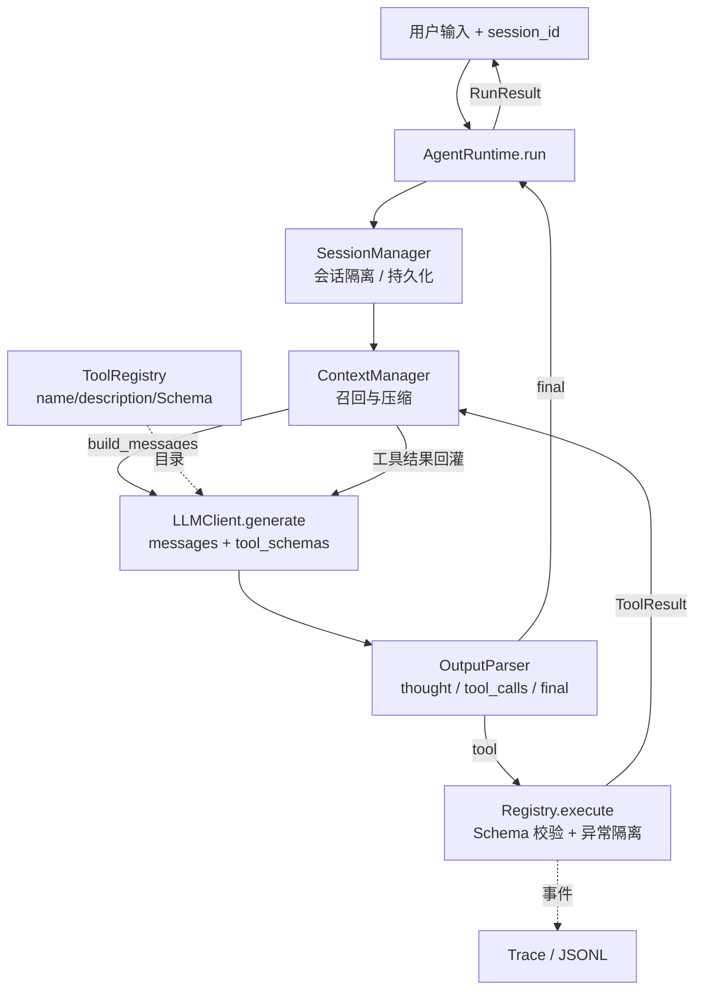

# Mini-Agent｜从零实现的最小可用 Agent Runtime

一个**不依赖 langgraph / openhands / openclaw 或任何 agent 框架**的最小可用 Agent。
LangChain 式的编排、ReAct loop、工具注册、输出解析、会话隔离、context 管理、trace 全部由本仓库自己实现；
LLM 只是被抽象成 `generate(messages, tool_schemas) -> LLMResponse` 的一个可替换组件。

运行时**零第三方依赖**（纯 Python 标准库），**零密钥也能跑完整流程**（自动降级为本地确定性替身）。

> **GitHub 仓库：https://github.com/ByteDancer95/mini-agent** （public）

---

## 1. 特性一览

| 能力 | 实现位置 | 说明 |
| --- | --- | --- |
| 主循环 | `core/runtime.py` | 接收输入 → 判断直答/调工具 → 执行 → 依据结果继续 loop 或返回答案 |
| 工具注册 | `core/registry.py` | name + description + 参数 JSON Schema，LLM 基于 Schema 自主决策 |
| 输出解析 | `core/parser.py` | 提取 thought / tool_calls / final answer，多级容错 |
| 工具集 | `tools/` | `calculator`、`search`(mock)、`todo`(必需) + 扩展 `weather`、`read_docs` |
| 多 session 隔离 | `core/session.py` | 历史与 todo 状态按会话私有，可随时切回继续对话，支持落盘恢复 |
| context 管理 | `core/context.py` | 最大轮次、历史保留、纯对话/带工具追问、基础压缩 |
| trace / 日志 | `core/trace.py` | 结构化事件 + JSONL 落盘 + 可读执行日志 |
| 异常处理 | 全链路 | 工具级 / 解析级 / LLM 级 / Runtime 边界四级兜底 |
| 无密钥 | `core/llm.py` | Key / Base URL / Model 只读环境变量，源码无任何凭据或厂商地址 |

---

## 2. 快速开始

要求：Python ≥ 3.10（开发环境为 Python 3.14）。无需 `pip install`。

```bash
git clone https://github.com/ByteDancer95/mini-agent.git
cd mini-agent

# ① 零密钥：直接跑题目指定的双窗口隔离演示
python -m mini_agent.demo

# ② 交互式 REPL（未配置 LLM 时自动使用 HeuristicLLM 演示模式）
python -m mini_agent.cli
python -m mini_agent.cli --trace --trace-file logs/agent_trace.jsonl

# ③ 运行全部测试
python -m unittest discover -s tests -v
```

### 接入真实 LLM（可选）

```bash
cp .env.example .env        # 填入自己的值；.env 已被 .gitignore 忽略
```

`.env` 中只放下面这些变量名（**值不要写进任何 .py 文件**）：

```ini
# 把值填在等号后面（此文件不要提交）
MINI_AGENT_API_KEY=
MINI_AGENT_BASE_URL=
MINI_AGENT_MODEL=
MINI_AGENT_LLM_PROTOCOL=json
MINI_AGENT_TIMEOUT=60
```

变量含义：密钥 / OpenAI 兼容端点（通常以 `/v1` 结尾）/ 模型名 /
`json` 或 `native`（使用厂商 function calling）/ 超时秒数。
也兼容 `OPENAI_API_KEY` / `OPENAI_BASE_URL` / `OPENAI_MODEL`。然后：

```bash
python -m mini_agent.cli --llm openai
python -m mini_agent.cli --llm auto       # 默认：配置齐全用真实模型，否则演示模式
```

> `json` 模式把工具目录和自研输出协议写进 system prompt，任何 OpenAI 兼容端点都能用；
> `native` 模式把 Schema 放进 Chat Completions 的 `tools` 参数并解析原生 `tool_calls`。
> 两种模式共用**同一个 Runtime**，切换只需改环境变量。

### REPL 命令

```
/list            列出 session
/use <id>        切换 session（切回即可继续之前的对话）
/new <id>        新建并切换
/todos           查看当前 session 待办
/history         查看当前 session 历史
/tools           查看已注册工具
/trace on|off    切换 trace 打印
/reset           清空当前 session
/quit            退出
```

### 指定持久化目录（跨进程继续对话）

```bash
python -m mini_agent.cli --persist .mini_agent_sessions
# 第一次问完后退出，第二次启动用同一个 --persist 与 /use <同一 id> 即可接着聊
```

---

## 3. 目录结构

```
mini-agent/
├── README.md                 本文件
├── PROMPT_LOG.md             AI Prompt 与问题解决记录
├── .env.example              仅变量名占位，不含值
├── .gitignore
├── docs/                     read_docs 工具读取的本地文档
│   ├── weekly_report_template.md
│   └── sample_notes.md
├── mini_agent/
│   ├── core/
│   │   ├── types.py          Message / ToolCall / ToolSpec / ToolResult / AgentOutput ...
│   │   ├── errors.py         异常类型
│   │   ├── prompt.py         系统提示词 + 输出协议（含 force_final / repair 提示）
│   │   ├── llm.py            OpenAICompatLLM / HeuristicLLM / ScriptedLLM
│   │   ├── parser.py         LLM 输出解析（thought / tool_calls / final）
│   │   ├── registry.py       工具注册 + 最小 JSON Schema 校验 + 安全执行
│   │   ├── context.py        context 写入策略 / 召回 / 基础压缩
│   │   ├── session.py        Session + SessionManager（隔离 + 持久化）
│   │   ├── trace.py          Trace / TraceEvent / JSONL Sink
│   │   └── runtime.py        ★ Agent Runtime 主循环
│   ├── tools/
│   │   ├── base.py           装配工厂（3 必需 / +2 扩展）
│   │   ├── calculator.py     AST 白名单安全求值
│   │   ├── search.py         mock 检索语料
│   │   ├── todo.py           会话级待办
│   │   ├── weather.py        mock 天气（扩展示例）
│   │   └── read_docs.py      本地文档读取（扩展示例）
│   ├── cli.py                交互式 CLI
│   └── demo.py               双窗口隔离演示
└── tests/                     unittest 测试（也可用 pytest 运行）
```

---

## 4. 系统设计

### 4.1 分层架构



**关键解耦**：`LLMClient` 只有一个方法；`ToolRegistry` 的 `schemas()` 产物既进 system prompt 又进 native `tools`；
Runtime 只认识 `AgentOutput` 和 `ToolResult` 两种内部类型。换模型、加工具都不需要改主循环。

### 4.2 主循环（伪代码）

```
run(session_id, user_input):
    session = sessions.get_or_create(session_id)       # 召回长期会话记忆
    ctx.add_user(user_input)
    for round in 1..max_tool_rounds:
        messages = ctx.build_messages(system_prompt, state_snapshot)   # 召回工作记忆
        output   = parse( llm.generate(messages, registry.schemas()) )
        record_thought(output.thought)                 # 只进审计 + trace
        if output.is_final:
            ctx.add_final(output.final_answer); return ok
        if output.has_tool_calls:
            ctx.add_decision(output)                   # 去掉 thought 后写入历史
            for call in output.tool_calls:
                result = registry.execute(call, ToolContext(session))   # 永不抛异常
                ctx.add_tool_result(call, result)
                trace(tool_call, tool_result)
            if ctx.maybe_compact(): trace(compact)
            continue                                  # 依据工具结果进入下一轮
    # 用尽轮次：force_final 一次；仍不收尾则基于已得结果兜底
    return loop_limit
```

「依据工具结果决定继续 loop 或返回最终答案」这一步由**下一轮 LLM 看到 `role=tool` 消息后重新决策**完成：
结果回灌进 context，模型自行判断信息是否充分，Runtime 不硬编码任何「调完工具就结束」的规则。

### 4.3 工具注册机制

每个工具是 `ToolSpec(name, description, parameters: JSON Schema)` + 一个
`handler(args: dict, ctx: ToolContext) -> Any`。注册后 Schema 自动出现在给 LLM 的目录里。

```python
from mini_agent.core.registry import ToolRegistry
from mini_agent.core.types import ToolSpec

reg = ToolRegistry()
reg.register(ToolSpec("echo", "回显文本", {
    "type": "object",
    "properties": {"text": {"type": "string"}},
    "required": ["text"],
    "additionalProperties": False,
}), lambda args, ctx: {"text": args["text"], "session": ctx.session_id})

# 或装饰器写法
@reg.tool("echo2", "回显", {...})
def echo2(args, ctx): ...
```

`build_default_registry(extensions=[...])` 演示了「从 `weather` / `read_docs` 中自定义扩展」：
不传 `extensions` 挂载全部扩展，传 `[]` 就是题目要求的 3 个必需工具。

Schema 校验实现了 `type / required / properties / additionalProperties / enum / minimum /
maximum / minLength / maxLength / pattern / items / minItems / maxItems` 子集，零第三方依赖。
校验失败不会打断 loop，而是变成 `ToolResult(ok=False, error=...)` **回喂给 LLM**，让它自己改参数重试。

### 4.4 LLM 输出协议与解析

默认 `json` 协议要求模型只输出**一个** JSON 对象：

```json
{"thought": "简要推理",
 "action": {"type": "tool", "tool_calls": [{"name": "calculator",
                                            "arguments": {"expression": "1+2"}}]}}
```
或
```json
{"thought": "信息已足够",
 "action": {"type": "final", "content": "最终答案"}}
```

`OutputParser` 的容错顺序：
原生 `tool_calls` → 完整 JSON → 剥离 ` ```json ` 围栏 → 从夹带文字中按**大括号配对**抠出 JSON →
完全不是 JSON 就降级成「纯文本最终答案」（不崩溃）。
同时兼容 `args / parameters / input / function.arguments` 等常见字段别名与扁平 `tool_calls` 写法。

### 4.5 多 session 隔离

* `SessionManager` 只维护 `id -> Session`；每个 `Session` 独享 `ContextManager` 和 `state`。
* 有状态工具（todo）**只读写 `ctx.state`**，而 `ctx.state` 就是该 session 的 `state`；
  代码里不存在模块级全局待办列表。
* Runtime 每轮构造 `ToolContext(session_id, state=session.state, docs_root=...)`，工具拿不到别人的数据。
* 开启 `--persist` 后每次 run 结束把 `context + state` 写成 `session_<sha256(id)[:24]>.json`，
  下次启动 `get_or_create` 自动加载 → **随时继续对话**（含跨进程）。文件名用哈希，避免 id 直接当路径。

题目场景对应 `mini_agent/demo.py`：

| 窗口 | 第一轮 | 追问 | 期望 |
| --- | --- | --- | --- |
| `userA/window1` | 查广州天气 + 记「喷药」待办 | 带工具追问列待办 / 换话题算数 | 只看到自己的待办与历史 |
| `userA/window2` | 写周报 + 记「提交课程报告」待办 | 纯对话追问（不调工具） | 只看到自己的待办与历史 |

---

## 5. Context 管理：memory 的**召回时机**与**放置方式**

> 这是本项目最核心的设计取舍，单独说明。

### 5.1 召回时机（when）

| 时机 | 触发点 | 召回什么 |
| --- | --- | --- |
| **每轮 LLM 调用前** | `ContextManager.build_messages()` | 短期/工作记忆：系统提示词、压缩摘要、状态快照、最近历史消息 |
| **收到用户输入时** | `run()` → `ctx.add_user()` | 本轮输入立即进入历史，同一次 loop 的所有迭代都能看到 |
| **每次工具返回后** | `ctx.add_tool_result()` → 下一轮 `build_messages()` | 工具结果作为下一轮决策的事实依据 |
| **切回 / 重启 session** | `SessionManager.get_or_create()`，命中内存或从 JSON 恢复 | 长期会话记忆：完整历史 + todo 状态 + 审计记录 |

纯对话追问与带工具追问**共用同一份** `_messages`：区别仅在于本轮是否额外追加 `tool` 消息。
因此「继续，把我的待办列出来」（带工具）和「不用工具，复述刚才的内容」（纯对话）都能读到上一轮问答。

### 5.2 放置方式（where）

`build_messages()` 返回给 LLM 的顺序是**固定的**：

```
[0] system  : 系统提示词（工具目录 + 输出协议）   ← 每轮重建，不存入历史
[1] system  : [Earlier conversation digest]      ← 压缩后的旧回合摘要
[2] system  : [Session state snapshot]           ← 当前 todo 清单（按需注入）
[3..] user / assistant / tool : 最近历史，按时间顺序原样保留
```

历史里三种消息的形态：

* `user` — 原始输入；
* `assistant`（工具决策） — 只保留 `{"action": {"type":"tool","tool_calls":[...]}}`，**剥离 thought**；
* `tool` — `<tool_result name="..." call_id="...">{...}</tool_result>`，超大 payload 按
  `tool_result_max_chars` 截断；
* `assistant`（最终答案） — 纯文本答案。

### 5.3 哪些信息**不**进入 LLM context（自行判断的结论）

| 信息 | 去向 | 理由 |
| --- | --- | --- |
| **Agent 思考过程 thought** | `ContextManager._audit`（会话审计，可持久化）+ `Trace` 的 `thought` 事件 | 中间推理回放会显著增加 token，且容易让模型复读上一步；观测/调试需要它，但决策不需要 |
| 超长工具 payload | 截断后只留前缀 | 防止 context 被单次检索结果撑爆 |
| 过旧的回合 | 压成 digest 一行 | 基础压缩，见 5.4 |
| 系统提示词 / 修复提示 | 每次临时构造 | 属于协议而非记忆，存下来会随工具表变化而过期 |

> 如果确实想把 thought 放进 context（例如做可解释性演示），
> 设 `ContextPolicy(include_thought_in_llm_context=True)` 或 CLI 加 `--include-thought`，无需改 Runtime。

### 5.4 最大轮次与基础压缩

* `RuntimeConfig.max_tool_rounds`（默认 5）限制**单次用户输入**内的工具迭代次数。
  用尽后：再给模型一次带「禁止调工具」指令的 `force_final` 机会；若模型仍要调工具或调用失败，
  Runtime 用已收集的工具结果合成兜底答案，返回 `status="loop_limit"`，绝不无限循环。
* 压缩阈值 `ContextPolicy.max_messages=40` / `max_chars=12000`。超限时把最旧的消息逐条折成
  `- user: ...` / `- tool[weather]: ...` 的 digest 行，保留最近 `keep_recent=12` 条原样，
  digest 本身再截断到 `digest_max_lines=20`；并保证压缩后至少保留最近一条 `user` 消息，
  否则追问会丢失指代对象。压缩事件会写进 trace。

---

## 6. Trace 与执行日志

每次 `run` 生成一个 `Trace`，事件类型包括：
`run_start / user_input / llm_call / llm_response / parse / thought / decision /
tool_call / tool_result / repair / compact / loop_limit / final / error / warning / session_save`。

* `result.trace.to_text()` → 人读的紧凑执行日志（CLI `--trace` 打印）；
* `TraceSink(path=...)` → 一行一事件的 JSONL，便于机器分析；
* 同时走标准库 `logging`（`mini_agent.trace` / `mini_agent.runtime`）。

示例：

```
[t01] decision       tool
[t01] tool_call      calculator({"expression": "18*24"})
[t01] tool_result    calculator ok=True 0.087ms {"ok": true, "result": {...}}
[t02] decision       final
[t02] final          已按你的要求完成：...
```

日志 payload 中**不含任何凭据**。

---

## 7. 异常处理分层

| 层级 | 状况 | 处理 |
| --- | --- | --- |
| 工具 | 未知工具 / 参数不满足 Schema / handler 抛异常 | 转成 `ToolResult(ok=False, error=...)` 回喂 LLM，loop 继续 |
| 解析 | 非法 JSON / 既非 final 也无 tool_calls | 先注入 `REPAIR_HINT` 让模型重写一次；仍失败则把原文降级为最终答案 |
| LLM | 网络 / HTTP / 响应格式错误 | 重试 1 次；仍失败抛 `LLMError`，异常消息不含 key |
| Runtime | 任何未预期异常（含非法 session id、持久化损坏） | 顶层捕获 → `RunResult(status="error")`，保留会话历史，不向调用方抛栈 |
| 安全 | `calculator` 收到 `__import__` / 属性访问 / 列表推导 | AST 白名单直接拒绝，绝不使用 `eval` |
| 安全 | `read_docs` 路径穿越 | `resolve()` 后校验必须位于 docs 根目录内 |

---

## 8. 测试

```bash
python -m unittest discover -s tests -v      # 零依赖，115 个用例
# 若已安装 pytest，也可用 pytest -q（unittest.TestCase 可被 pytest 直接收集）
```

本机验证：`Ran 115 tests ... OK`（Python 3.14.3）。

覆盖矩阵：

| 文件 | 覆盖点 |
| --- | --- |
| `test_registry.py` | 注册/装饰器/重复注册、Schema 校验（required/type/enum/边界）、未知工具、handler 异常隔离、自定义扩展 |
| `test_parser.py` | 标准协议、思考过程、并行工具调用、代码围栏、夹带文字、字段别名、纯文本降级、非法对象、native tool_calls |
| `test_tools.py` | calculator 运算/函数/别名/**注入攻击与除零**、search mock 确定性、todo 全生命周期与会话隔离、weather、read_docs 穿越防护 |
| `test_runtime.py` | 直答、工具→最终、多轮 loop、并行调用、工具错误回喂、解析修复、LLM 失败兜底、轮次上限 + 强制收尾、thought 不进 context、状态快照注入、两类追问保留历史 |
| `test_sessions.py` | 双窗口隔离、分别继续对话、跨 `SessionManager` 持久化恢复、损坏文件容错、哈希文件名、序列化 |
| `test_context.py` | 写入策略、build_messages 放置顺序、digest 召回、按条数/字数压缩、保留最近 user、序列化 |
| `test_llm.py` | 缺配置报错、源码无硬编码凭据、自动降级、`.env` 不覆盖进程环境、json/native 请求体、HTTP/网络异常 |
| `test_integration.py` | 完整双窗口演示通过、trace JSONL 落盘与不串台、CLI 入口、仓库无密钥、交付文件齐全 |

---

## 9. 安全约定

* **代码中不写任何 LLM API Key、Token、厂商地址**；配置只从环境变量 / 构造参数 / 未提交的 `.env` 读取。
* `.env`、会话状态目录、`logs/`、`*.jsonl` 全部被 `.gitignore` 忽略。
* 测试 `test_no_secrets...` 会扫描全部 `.py` 与 `.env.example`，发现疑似硬编码凭据即失败。
* `calculator` 基于 AST 白名单，`read_docs` 有路径穿越防护，session 文件名用哈希。

---

## 10. GitHub 仓库

本仓库已推送至 **https://github.com/ByteDancer95/mini-agent**（public，分支 `main`）。
若 fork 后要推到自己的账号：

```bash
git remote add origin https://github.com/<你的用户名>/mini-agent.git
git branch -M main
git push -u origin main
```

（若本机装有 `gh`：`gh repo create mini-agent --public --source=. --push`。）
提交历史中不含 `.env`、会话状态或任何密钥：推送前已用 `.gitignore` 过滤，
并有 `test_python_sources_have_no_hardcoded_credentials` 做回归检查。
